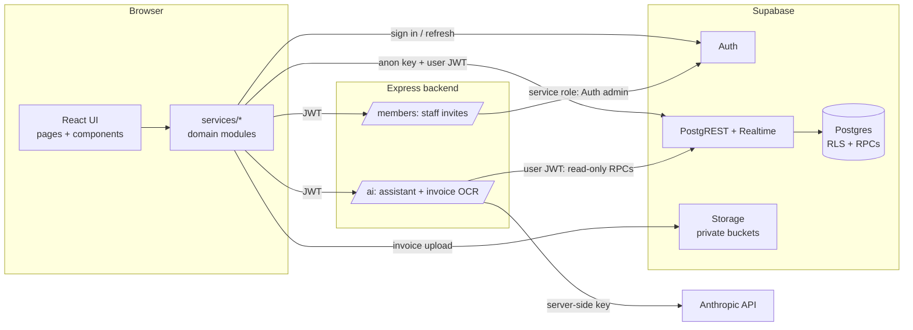
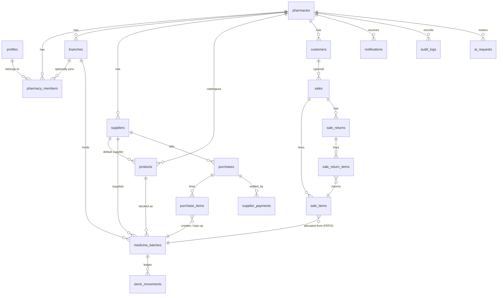
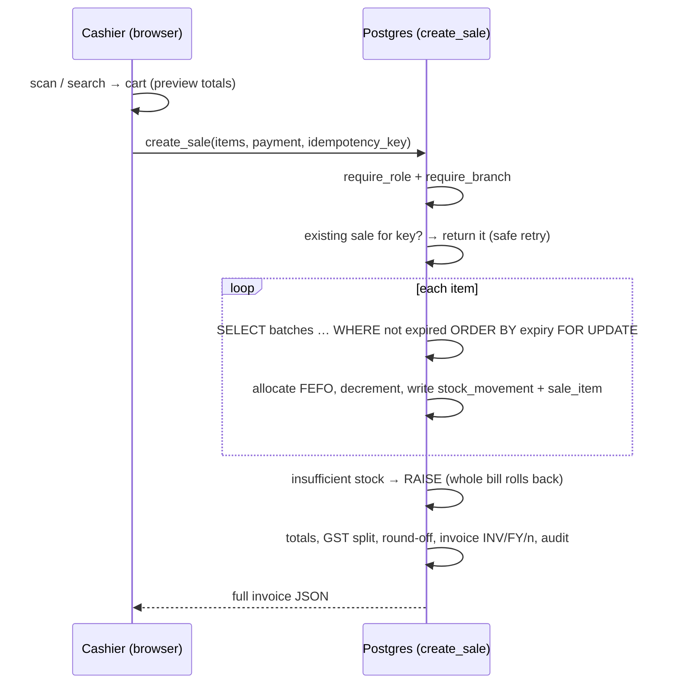

# System design — PharmaTrack Pro

## 1. Goals and constraints
- A pharmacy must only ever see its own data, enforced by the database, not the UI.
- Stock and money must never drift: every bill, return, purchase and adjustment is one transaction with a ledger row.
- Work at a busy counter: scan-first POS, keyboard friendly, safe to retry on bad networks.
- Indian retail conventions: MRP is tax-inclusive, GST slabs 0/5/12/18/28 %, April–March financial year, Schedule H/H1/X drugs.
- Keep the existing stack (React + Vite + Tailwind, Express, Supabase).

## 2. Architecture



| Layer | Responsibility | Trust |
|---|---|---|
| React UI | Layout, forms, previews, role-aware navigation | Untrusted |
| `services/*` | One module per domain (inventory, sales, purchases, suppliers, insights, notifications, pharmacy, ai) | Untrusted |
| Supabase RLS | Row visibility per tenant and role | **Enforcing** |
| RPCs (`SECURITY DEFINER`) | All stock/money writes; re-check role and branch; lock rows | **Enforcing** |
| Express | Only operations that need secrets: staff invites, AI | Enforcing for its endpoints |

Why not route everything through Express? Supabase already provides authenticated,
policy-checked data access. Duplicating it in Express would add a second place where
tenancy can go wrong. Business rules live once, in SQL, next to the data, and are
tested directly (`supabase/tests`).

## 3. Modules

| Module | Tables | Key RPCs / endpoints |
|---|---|---|
| Auth & access | `profiles`, `pharmacy_members` | `private.require_role`, `private.has_role` |
| Pharmacy & branches | `pharmacies`, `branches` | `create_pharmacy` |
| Catalogue | `products` | direct CRUD under RLS |
| Batches & expiry | `medicine_batches`, `product_stock` view | `add_opening_stock`, `adjust_stock`, `inventory_list`, `lookup_barcode` |
| Suppliers & purchases | `suppliers`, `purchases`, `purchase_items`, `supplier_payments` | `receive_purchase`, `record_supplier_payment`, `supplier_summary` |
| Sales & billing | `sales`, `sale_items`, `customers`, `document_sequences` | `create_sale`, `get_sale`, `pos_search` |
| Returns & cancellations | `sale_returns`, `sale_return_items` | `process_return`, `cancel_sale` |
| Stock ledger | `stock_movements` (append-only) | written by every stock RPC |
| Dashboard & reports | (read models) | `dashboard_summary`, `sales_report` |
| Alerts & notifications | `notifications` | `stock_alerts`, `refresh_alert_notifications` |
| Admin | `audit_logs` | `platform_overview`, `platform_update_pharmacy`, `POST /members` |
| AI | `ai_requests` (metadata only) | `POST /ai/ask`, `POST /ai/invoice-extract`, `reorder_suggestions`, `expiry_risk` |

## 4. Data model



Design notes:
- **Stock lives on batches** (`branch × product × batch_no`, unique). Products hold catalogue data only.
- `stock_movements.balance_after` and the test suite assert `Σ quantity_change = batch.quantity` for every batch.
- `sale_items` snapshot name, batch, expiry, price, MRP, cost and GST so invoices and margins stay correct after catalogue edits.
- Money is `numeric(12,2)`; quantities are integers with `CHECK (quantity >= 0)`.
- `pharmacies.settings` (validated by trigger) holds alert thresholds, discount caps, invoice prefix and the tax-inclusive flag.
- Demo rows carry `is_demo = true` and live in one fixed demo tenant.

## 5. Security model
1. **Every table has RLS.** Helpers `private.is_member`, `private.has_role`, `private.member_role` read `pharmacy_members` for `auth.uid()`; suspended pharmacies resolve to no role.
2. **Clients cannot write ledgers.** `INSERT/UPDATE/DELETE` on sales, purchases, returns, movements and audit tables is revoked from `authenticated`; a trigger rejects direct changes to batch quantity.
3. **RPCs re-check.** Each starts with `private.require_role(...)` and, for staff pinned to a branch, `private.require_branch(...)`.
4. **Cross-tenant references are rejected** by `private.assert_same_pharmacy()` (batch → product/branch/supplier, product → supplier, member → branch).
5. **Protected columns.** Users cannot set `is_platform_admin`; owners cannot change their own `status`, `plan` or `is_demo`.
6. **Secrets stay on the server.** The browser only has the anon key. The service-role key is used for Auth admin calls and metering; the Anthropic key only on the backend.
7. **No demo bypass.** Tokens are validated with Supabase Auth on every backend request.
8. **Storage** buckets are private; object paths start with the pharmacy id and policies check membership.

Role matrix: see the header of `supabase/migrations/20261114000005_rls.sql` and `frontend/src/lib/roles.js`.

## 6. Key workflows

### Billing (POS)

- Prices come from the batch, never the request. Expired batches are never sold.
- Discounts are capped per role (`max_discount_pct`, `cashier_max_discount_pct`).
- Schedule H/H1/X items require a doctor's name in the UI before checkout.

### Purchase receiving
`receive_purchase` validates supplier ownership, rejects expired stock and `selling > MRP`, finds or creates the batch (locking it), rejects a batch number that already exists with a different expiry, adds `quantity + free`, writes ledger rows, computes GST on rates, sets the due date from supplier terms and records any upfront payment. The `(supplier, invoice_no)` pair is unique, so the same bill cannot be entered twice.

### Returns and cancellations
- `process_return` (owner/manager/pharmacist): per line, at most `sold − returned`; refunds pro rata; restocks to the original batch unless the batch is expired or the reason is damaged / expired / adverse reaction.
- `cancel_sale` (owner/manager): only for bills without returns; restores every unit and marks the bill cancelled with a reason.

### Alerts
`stock_alerts` classifies batches (expired, ≤ critical days, ≤ warning days) and products (low, out, slow-moving, dead stock) using each pharmacy's thresholds. `refresh_alert_notifications` materialises them as deduplicated notifications (one per batch, or per product per ISO week), which realtime pushes to open sessions. It runs when an owner, manager or pharmacist opens the app (it needs a signed-in member). A nightly server-side job would need a service-role wrapper, which is not included yet.

### Barcode scanning
1. Camera: native `BarcodeDetector` where available, otherwise ZXing with retail formats and `TRY_HARDER`. The stream is requested with `facingMode: environment` before devices are enumerated, `playsInline` + `muted` are set for iOS, and a code must be read twice in a row before it is accepted.
2. USB/Bluetooth wedge scanners: a global listener recognises fast key bursts ending in Enter.
3. Manual entry is always available.
4. Every code is normalised (GS1 `(01)` GTIN, leading packaging zero) and numeric retail codes must pass their check digit.
5. `lookup_barcode` searches only the current pharmacy; a miss shows the code and offers **Register product** with the barcode pre-filled.

## 7. AI architecture
```
UI ──JWT──▶ POST /api/pharmacies/:id/ai/ask
             ├─ requireAuth (Supabase) → requireMember(owner|manager|pharmacist)
             ├─ per-pharmacy daily quota (ai_requests)
             ├─ Claude (claude-opus-5-5, adaptive thinking, server-side refusal fallback)
             │    tools: get_stock_alerts · get_reorder_suggestions · get_expiry_risk
             │           get_sales_summary · search_inventory      (read-only)
             │    each tool → RPC with the *user's* client → RLS-scoped
             └─ answer + tools used; usage metadata logged (no prompt text)
```
- The numbers come from deterministic SQL (`reorder_suggestions`, `expiry_risk`, `stock_alerts`, `dashboard_summary`); the model explains them. The same tables are shown in the UI without AI.
- No tool returns customer, prescription or staff data; `recent_sales` (customer names) is stripped before it reaches the model.
- No tool can write. Reorder and write-off suggestions require a person to act in the app.
- The system prompt forbids diagnosis, dosing, interaction checks and substitution advice; refusals become a scoped message.
- **Invoice OCR**: the file is uploaded to private storage, downloaded by the backend with the user's client (storage RLS), sent to Claude with a JSON schema (structured outputs), validated with zod, matched to the catalogue, and returned as a draft with per-line warnings. It is never saved until the user reviews it and submits the purchase form, which goes through `receive_purchase` and all of its validations.

Planned (foundation in place): natural-language reports over `sales_report`, demand forecasting beyond moving averages, supplier price comparison across purchases.

## 8. Operations
- Migrations: `supabase/migrations/*` (apply with `supabase db push`).
- Tests: `npm test` runs database (PGlite, real Postgres), backend and frontend suites.
- Demo tenant: `npm run seed:demo` (idempotent).
- Platform admin: `npm run platform-admin -- email@example.com`.
- Alerts refresh when staff open the app; there is no scheduled job yet.
